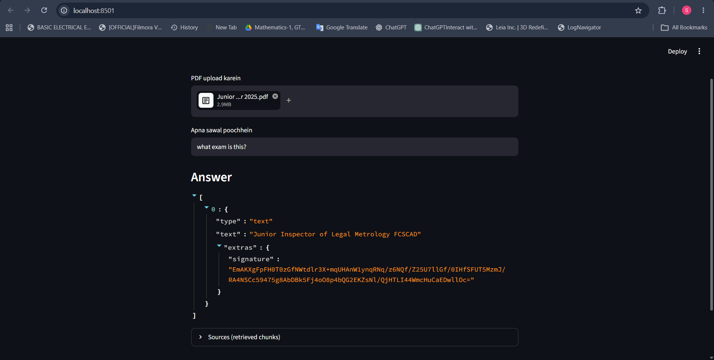
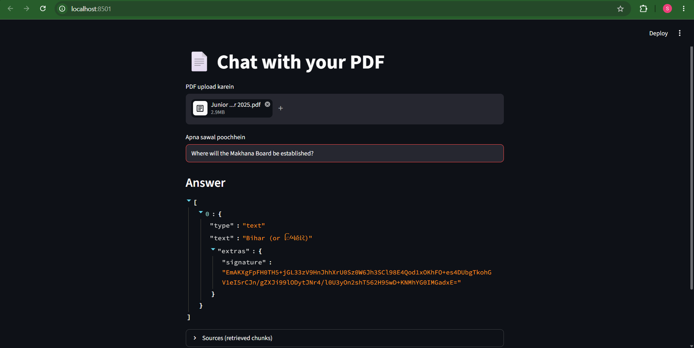
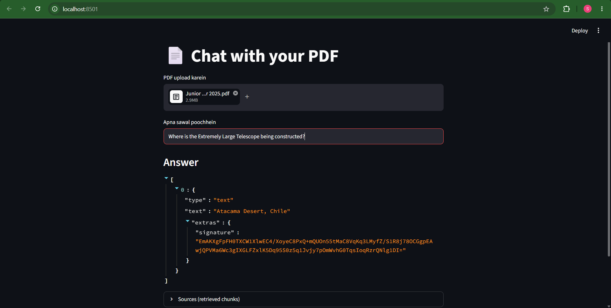
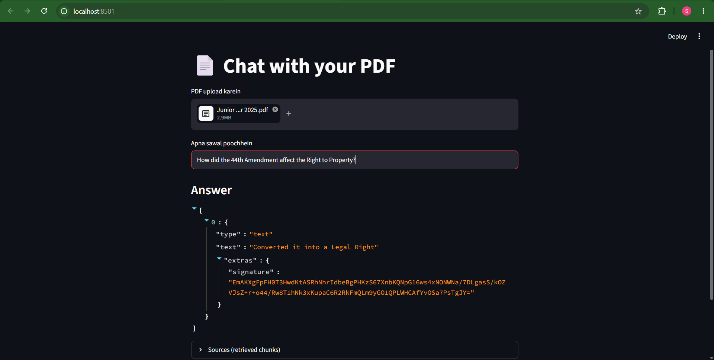

# 📄 Chat with PDF — RAG Chatbot

A Retrieval-Augmented Generation (RAG) app that lets you upload a PDF and ask questions about it.
Answers are grounded in the document, and the retrieved source chunks are shown for verification.
It works with **bilingual (English + Gujarati) PDFs** thanks to a multilingual embedding model.

## How it works

1. **Load** the PDF (`PyPDFLoader`)
2. **Chunk** the text (`RecursiveCharacterTextSplitter`, 1000 chars, 150 overlap)
3. **Embed** chunks locally with Hugging Face `paraphrase-multilingual-MiniLM-L12-v2` (no API key needed)
4. **Store** vectors in **ChromaDB**
5. **Retrieve** the top-8 similar chunks for a question (semantic search), and always include the first chunk (title / exam name)
6. **Generate** the answer with Gemini using only the retrieved context

## Tech Stack

Python, LangChain, ChromaDB, Hugging Face sentence-transformers (embeddings), Gemini API, Streamlit

## Screenshots

Tested on a 72-page bilingual (English + Gujarati) exam paper.

**Identifying the document**



**Factual question: Union Budget**



**Factual question: current affairs**



**Factual question: Constitution of India**



## Setup

```bash
git clone https://github.com/<your-username>/rag-pdf-chatbot.git
cd rag-pdf-chatbot
python -m venv venv
venv\Scripts\activate        # Mac/Linux: source venv/bin/activate
pip install -r requirements.txt
```

Get a free Gemini API key from [aistudio.google.com/apikey](https://aistudio.google.com/apikey), then set it.

**Windows (PowerShell):**

```powershell
$env:GOOGLE_API_KEY="your_key_here"
```

**Mac/Linux:**

```bash
export GOOGLE_API_KEY="your_key_here"
```

Or copy `.env.example` to `.env` and put your key there. Never commit your real key.

Run the app:

```bash
streamlit run app.py
```

The first run downloads the embedding model (~470 MB), so it can take a few minutes.

## Limitations

- Retrieval returns only the top-k chunks, so whole-document questions (total count, full summary) are weak.
- Scanned (image-only) PDFs are not supported because there is no OCR.
- Only text is read. Icons and images (for example, green ticks marking correct options) are not seen.
- One PDF at a time, and no chat history.

## Future Improvements

- Multiple PDF support
- Chat history / memory
- Persistent ChromaDB storage
- OCR for scanned PDFs
- Evaluation of retrieval quality


---

## 👤 Author

**Patel Mohammadsaad**
Python · Data Analysis · Gen AI

- GitHub: [github.com/your-username](https://github.com/Patelmohammadsaad)
- LinkedIn: [linkedin.com/in/your-profile](https://www.linkedin.com/in/saadpatel26/?isSelfProfile=true)
- Email: saadpatel2023@gmail.com